# Enterprise Network Implementation (Headquarters & Branch)

*Platform: Cisco Packet Tracer*

## 1. Project Overview & Business Logic

This project documents the implementation of a secure, multi-site enterprise network connecting a Headquarters (HQ) and a Branch Office, built in Cisco Packet Tracer.

**Business Objectives & Architecture**

* **Layer 2 Segmentation:** The flat network model is eliminated by creating VLANs. Standard workstations are isolated from the IT management and monitoring infrastructure at both sites.
* **Layer 3 Scalability:** A Router-on-a-Stick (802.1Q) architecture allows future VLAN expansion without requiring additional physical router interfaces. (A single trunk is also a bandwidth bottleneck and a single point of failure; a Layer 3 switch or redundant uplinks would address this in production.)
* **Dynamic Routing:** OSPFv2 (Area 0) provides automatic route discovery across the point-to-point WAN link (/30).
* **Endpoint Automation:** DHCP services run on the edge routers. Router gateway IPs are excluded from the pools, while the Syslog server is statically assigned in HQ VLAN 10, which intentionally has no DHCP pool.
* **DHCP Design Justification:** HQ Management (VLAN 10) uses static addressing only, because it hosts fixed server infrastructure (Syslog). Branch Management (VLAN 30) uses a DHCP pool to support mobile IT administrator workstations on site.
* **Router Monitoring & Security:** Router event logs are centralized on a Syslog server with millisecond timestamps. Layered extended Access Control Lists (ACLs) are deployed at both sites: inbound ACLs on the user sub-interfaces block unauthorized traffic at its source, and outbound ACLs on the management sub-interfaces enforce the same policy at the destination. Cross-site IT communication remains permitted.
* **Note on External Connectivity:** This lab covers internal WAN connectivity only. The DNS server (8.8.8.8) is configured in the DHCP pools as a placeholder for future NAT and default-route implementation.

---

## 2. Topology, Hardware & Cabling

The network uses a point-to-point WAN topology connecting two star-topology LANs.

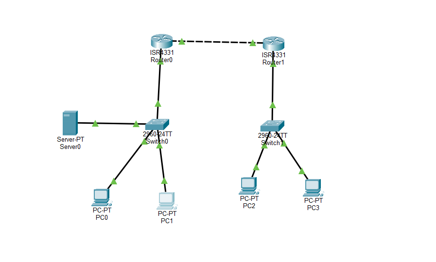

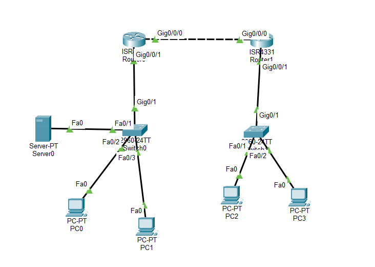

*Figure 1a: HQ (Router0, Switch0, Server0, PC0-PC1) and Branch (Router1, Switch1, PC2-PC3) connected by a point-to-point WAN link. Figure 1b: the same topology with port labels, which match the cabling list below.*

**Hardware Utilized**

* 2x Cisco ISR 4331 routers (inter-VLAN routing, OSPF, DHCP, extended ACLs, Syslog forwarding)
* 2x Cisco Catalyst 2960-24TT switches (Layer 2 access, 802.1Q trunking)
* 1x Server-PT (centralized Syslog collector, static IP)
* 4x PC-PT (end-user and IT workstations, IP via DHCP)

**Physical Cabling**

* **WAN:** `Router0 (G0/0/0)` <--> Copper Cross-Over <--> `Router1 (G0/0/0)`
* **HQ LAN:** `Router0 (G0/0/1)` <--> Copper Straight-Through <--> `Switch0 (G0/1)`
* **Branch LAN:** `Router1 (G0/0/1)` <--> Copper Straight-Through <--> `Switch1 (G0/1)`
* **HQ Endpoints:** `Switch0 (Fa0/1)` to `Server0`; `Switch0 (Fa0/2 - 0/3)` to `PC0` and `PC1`
* **Branch Endpoints:** `Switch1 (Fa0/1)` to `PC2`; `Switch1 (Fa0/2)` to `PC3`

---

## 3. IP Addressing and VLAN Schema

The WAN link uses a `/30` mask to avoid wasting addresses on a point-to-point Ethernet link.

| Site / Device | VLAN | Network Name | Subnet (CIDR) | Default Gateway |
| :--- | :--- | :--- | :--- | :--- |
| **Point-to-Point WAN** | - | WAN_Link | 10.0.0.0 /30 | - |
| **HQ - Management** | 10 | Management | 192.168.10.0 /24 | 192.168.10.254 |
| **HQ - Users** | 20 | Users | 192.168.20.0 /24 | 192.168.20.254 |
| **Branch - Management** | 30 | Branch_Management | 192.168.30.0 /24 | 192.168.30.254 |
| **Branch - Users** | 40 | Branch_Users | 192.168.40.0 /24 | 192.168.40.254 |
| **Syslog Server (HQ)** | 10 | Management | 192.168.10.10 /24 | 192.168.10.254 |

---

## 4. Executed Configurations

### Phase 1: Layer 2 Configuration (Switches)

Access ports are isolated per VLAN, and 802.1Q trunk ports are restricted to the required VLANs to limit unnecessary VLAN propagation and reduce the attack surface. (Fully mitigating VLAN hopping also requires native VLAN changes, `switchport nonegotiate` and shutting down unused ports; see Future Improvements.)

**Switch0 (HQ)**

```text
enable
configure terminal
hostname Switch0
vlan 10
 name Management
vlan 20
 name Users
exit
interface fastEthernet 0/1
 switchport mode access
 switchport access vlan 10
interface range fastEthernet 0/2 - 3
 switchport mode access
 switchport access vlan 20
interface gigabitEthernet 0/1
 switchport mode trunk
 switchport trunk allowed vlan 10,20
exit
```

**Switch1 (Branch)**

```text
enable
configure terminal
hostname Switch1
vlan 30
 name Branch_Management
vlan 40
 name Branch_Users
exit
interface fastEthernet 0/1
 switchport mode access
 switchport access vlan 30
interface fastEthernet 0/2
 switchport mode access
 switchport access vlan 40
interface gigabitEthernet 0/1
 switchport mode trunk
 switchport trunk allowed vlan 30,40
exit
```

**Verification: VLANs and trunks**

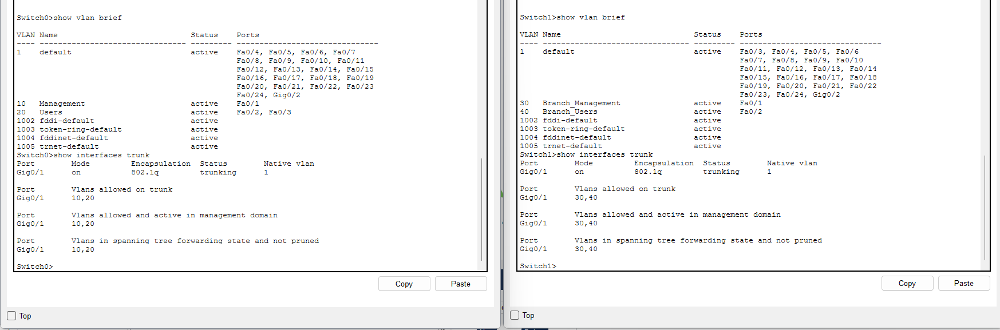

*Figure 2: `show vlan brief` and `show interfaces trunk` on Switch0 (left) and Switch1 (right). Access ports are in the correct VLANs, and each trunk carries only its own two VLANs (10,20 and 30,40).*

### Phase 2: Layer 3 Configuration (Routers, DHCP and OSPF)

The physical parent interfaces are enabled (`no shutdown`) before the 802.1Q sub-interfaces are created, followed by OSPFv2 and DHCP provisioning.

**Router0 (HQ)**

```text
enable
configure terminal
hostname Router0
interface gigabitEthernet 0/0/0
 ip address 10.0.0.1 255.255.255.252
 no shutdown
exit
interface gigabitEthernet 0/0/1
 no ip address
 no shutdown
exit
interface gigabitEthernet 0/0/1.10
 encapsulation dot1Q 10
 ip address 192.168.10.254 255.255.255.0
exit
interface gigabitEthernet 0/0/1.20
 encapsulation dot1Q 20
 ip address 192.168.20.254 255.255.255.0
exit
router ospf 1
 network 10.0.0.0 0.0.0.3 area 0
 network 192.168.10.0 0.0.0.255 area 0
 network 192.168.20.0 0.0.0.255 area 0
exit
ip dhcp excluded-address 192.168.20.254
ip dhcp pool HQ_USERS
 network 192.168.20.0 255.255.255.0
 default-router 192.168.20.254
 dns-server 8.8.8.8
exit
```

**Router1 (Branch)**

```text
enable
configure terminal
hostname Router1
interface gigabitEthernet 0/0/0
 ip address 10.0.0.2 255.255.255.252
 no shutdown
exit
interface gigabitEthernet 0/0/1
 no ip address
 no shutdown
exit
interface gigabitEthernet 0/0/1.30
 encapsulation dot1Q 30
 ip address 192.168.30.254 255.255.255.0
exit
interface gigabitEthernet 0/0/1.40
 encapsulation dot1Q 40
 ip address 192.168.40.254 255.255.255.0
exit
! Loopback interface provisioned for administrative/Syslog testing
interface loopback 0
 ip address 172.16.1.1 255.255.255.255
exit
router ospf 1
 network 10.0.0.0 0.0.0.3 area 0
 network 192.168.30.0 0.0.0.255 area 0
 network 192.168.40.0 0.0.0.255 area 0
exit
ip dhcp excluded-address 192.168.30.254
ip dhcp excluded-address 192.168.40.254
ip dhcp pool BRANCH_MANAGEMENT
 network 192.168.30.0 255.255.255.0
 default-router 192.168.30.254
 dns-server 8.8.8.8
exit
ip dhcp pool BRANCH_USERS
 network 192.168.40.0 255.255.255.0
 default-router 192.168.40.254
 dns-server 8.8.8.8
exit
```

*Note on configuration order:* The listings above are consolidated in logical order. On Router1, `Loopback0` was given its address after OSPF was already running, so the OSPF router ID had already been selected (`192.168.40.254`, as shown in Figure 4) instead of `172.16.1.1`. IOS chooses the router ID when the OSPF process starts, preferring the highest loopback address, then the highest active interface address.

**Verification: interfaces and DHCP**

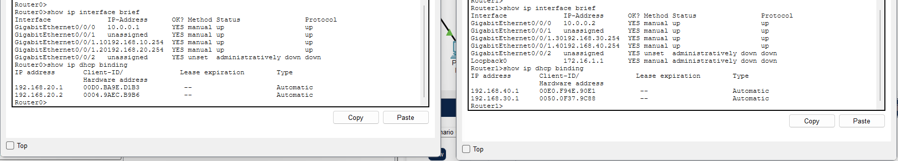

*Figure 3: `show ip interface brief` and `show ip dhcp binding` on Router0 (left) and Router1 (right). The WAN interface and all four sub-interfaces are up/up with the correct addresses, and each router has leased addresses from its own pools. Router1's `Loopback0` appears administratively down because it was shut down as part of the Syslog test (Section 5.3).*

### Phase 3: Layered Security (ACLs) and Router Logging

Millisecond timestamps are enabled for router Syslog messages. Extended ACLs are applied in two layers on each router: an **inbound** ACL on the user sub-interface drops unauthorized traffic at its source (including traffic aimed at the management gateway IPs), and an **outbound** ACL on the management sub-interface enforces the same policy at the destination while preserving cross-site IT administration.

**Router0 (HQ Security & Logging)**

```text
enable
configure terminal
service timestamps log datetime msec
logging 192.168.10.10

! Layer 1 (source): block HQ Users from reaching any management VLAN
ip access-list extended HQ_USERS_IN
 deny ip 192.168.20.0 0.0.0.255 192.168.10.0 0.0.0.255
 deny ip 192.168.20.0 0.0.0.255 192.168.30.0 0.0.0.255
 permit ip any any
exit
interface gigabitEthernet 0/0/1.20
 ip access-group HQ_USERS_IN in
exit

! Layer 2 (destination): protect HQ Management (VLAN 10)
ip access-list extended SECURE_MANAGEMENT
 ! Permit Branch IT (VLAN 30) to reach HQ Management (VLAN 10)
 permit ip 192.168.30.0 0.0.0.255 192.168.10.0 0.0.0.255
 ! Deny local HQ Users (VLAN 20)
 deny ip 192.168.20.0 0.0.0.255 192.168.10.0 0.0.0.255
 ! Deny remote Branch Users (VLAN 40)
 deny ip 192.168.40.0 0.0.0.255 192.168.10.0 0.0.0.255
 ! Permit all other transit traffic (e.g. Syslog packets sourced from 10.0.0.2)
 permit ip any any
exit
interface gigabitEthernet 0/0/1.10
 ip access-group SECURE_MANAGEMENT out
exit
```

**Router1 (Branch Security & Logging)**

```text
enable
configure terminal
service timestamps log datetime msec
logging 192.168.10.10

! Layer 1 (source): block Branch Users from reaching any management VLAN
ip access-list extended BRANCH_USERS_IN
 deny ip 192.168.40.0 0.0.0.255 192.168.30.0 0.0.0.255
 deny ip 192.168.40.0 0.0.0.255 192.168.10.0 0.0.0.255
 permit ip any any
exit
interface gigabitEthernet 0/0/1.40
 ip access-group BRANCH_USERS_IN in
exit

! Layer 2 (destination): protect Branch Management (VLAN 30)
ip access-list extended BRANCH_SECURE_MGMT
 ! Permit HQ Management (VLAN 10) to reach Branch IT (VLAN 30)
 permit ip 192.168.10.0 0.0.0.255 192.168.30.0 0.0.0.255
 ! Deny remote HQ Users (VLAN 20)
 deny ip 192.168.20.0 0.0.0.255 192.168.30.0 0.0.0.255
 ! Deny local Branch Users (VLAN 40)
 deny ip 192.168.40.0 0.0.0.255 192.168.30.0 0.0.0.255
 ! Permit all other traffic
 permit ip any any
exit
interface gigabitEthernet 0/0/1.30
 ip access-group BRANCH_SECURE_MGMT out
exit
```

**Design note: why `permit ip any any`.** The ACLs follow a blacklist model: they block the specific flows that matter (user VLANs reaching management VLANs) and leave everything else open, so DHCP, OSPF, Syslog and normal routing keep working without enumerating every protocol. A production policy would use a whitelist for the management VLANs instead (see Future Improvements).

---

## 5. Validation and Operational Testing

### 5.1 OSPF Routing Convergence

```text
Router1#show ip route
Gateway of last resort is not set

     10.0.0.0/8 is variably subnetted, 2 subnets, 2 masks
C       10.0.0.0/30 is directly connected, GigabitEthernet0/0/0
L       10.0.0.2/32 is directly connected, GigabitEthernet0/0/0
O    192.168.10.0/24 [110/2] via 10.0.0.1, 00:14:14, GigabitEthernet0/0/0
O    192.168.20.0/24 [110/2] via 10.0.0.1, 00:14:14, GigabitEthernet0/0/0
     192.168.30.0/24 is variably subnetted, 2 subnets, 2 masks
C       192.168.30.0/24 is directly connected, GigabitEthernet0/0/1.30
L       192.168.30.254/32 is directly connected, GigabitEthernet0/0/1.30
     192.168.40.0/24 is variably subnetted, 2 subnets, 2 masks
C       192.168.40.0/24 is directly connected, GigabitEthernet0/0/1.40
L       192.168.40.254/32 is directly connected, GigabitEthernet0/0/1.40
```

*Result:* Router1 learns the two HQ subnets dynamically through OSPF (Area 0) across the `/30` WAN link, alongside its own connected and local routes. The absence of a default route (`Gateway of last resort is not set`) is consistent with the intranet-only scope of this lab.

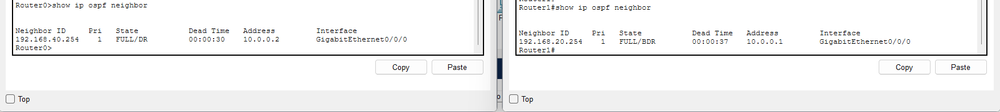

*Figure 4: `show ip ospf neighbor` on Router0 (left) and Router1 (right). Each router sees the other in the `FULL` state on `GigabitEthernet0/0/0`, confirming the adjacency. Because the WAN interfaces use the default OSPF network type for Ethernet (broadcast), a DR/BDR election takes place even on this two-router link; this is harmless here (see Future Improvements).*

### 5.2 ACL Verification

| Test | Source | Destination | Expected | Rule validated |
| :--- | :--- | :--- | :--- | :--- |
| **A** | PC0 (HQ Users, `192.168.20.1`) | Syslog Server (`192.168.10.10`) | Blocked | `HQ_USERS_IN`: deny VLAN 20 to VLAN 10 |
| **B** | PC3 (Branch Users, `192.168.40.1`) | Syslog Server (`192.168.10.10`) | Blocked | `SECURE_MANAGEMENT` (initial design) and `BRANCH_USERS_IN`: deny VLAN 40 to VLAN 10 |
| **C** | PC3 (Branch Users, `192.168.40.1`) | PC2 (Branch IT, `192.168.30.1`) | Blocked | `BRANCH_USERS_IN`: deny VLAN 40 to VLAN 30 |
| **D** | PC2 (Branch IT, `192.168.30.1`) | Syslog Server (`192.168.10.10`) | Permitted | `SECURE_MANAGEMENT`: permit VLAN 30 to VLAN 10 |
| **E** | PC0 (HQ Users, `192.168.20.1`) | PC3 (Branch Users, `192.168.40.1`) | Permitted | `permit ip any any` (inter-site user routing) |
| **F** | PC3 (Branch Users, `192.168.40.1`) | Branch gateway (`192.168.30.254`) | Blocked (permitted in the initial design) | `BRANCH_USERS_IN`: deny VLAN 40 to VLAN 30 (covers the gateway IP) |

**Observed results**

* **Test A:** `Reply from 192.168.20.254: Destination host unreachable` (4/4 packets lost).
* **Test B:** In the initial outbound-only design the ping was blocked at HQ (`Destination host unreachable`, 4/4 packets lost, reply from `10.0.0.1`, Router0's WAN interface). The deny for VLAN 40 to VLAN 10 now also exists in `BRANCH_USERS_IN`, so this traffic is dropped at the Branch.
* **Test C:** `Reply from 192.168.40.254: Destination host unreachable` (4/4 packets lost).
* **Test D:** `Reply from 192.168.10.10: bytes=32 time<1ms TTL=126`.
* **Test E:** `Reply from 192.168.40.1: bytes=32 time<1ms TTL=126`.
* **Test F:** In the initial design the ping succeeded (`Reply from 192.168.30.254: bytes=32 time<1ms TTL=255`; TTL 255 shows the reply was generated by the router itself). After the inbound ACLs were added, the same ping returns `Reply from 192.168.40.254: Destination host unreachable` (4/4 packets lost). See Figure 8.

*Note:* Each "unreachable" reply comes from the router interface the original packet entered (`192.168.20.254` in Test A, `192.168.40.254` in Tests C and F), because the router returns the ICMP message toward the sender through that interface.

**Evidence**

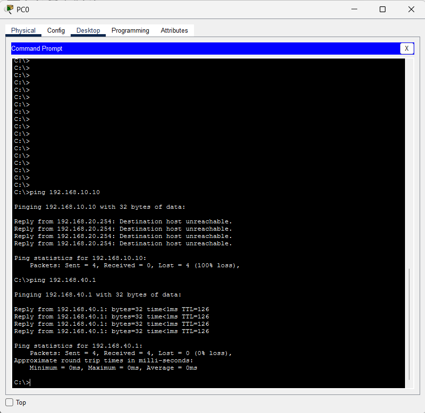

*Figure 5: PC0 command prompt. The ping to the Syslog Server is blocked (Test A), and the ping to PC3 succeeds (Test E).*

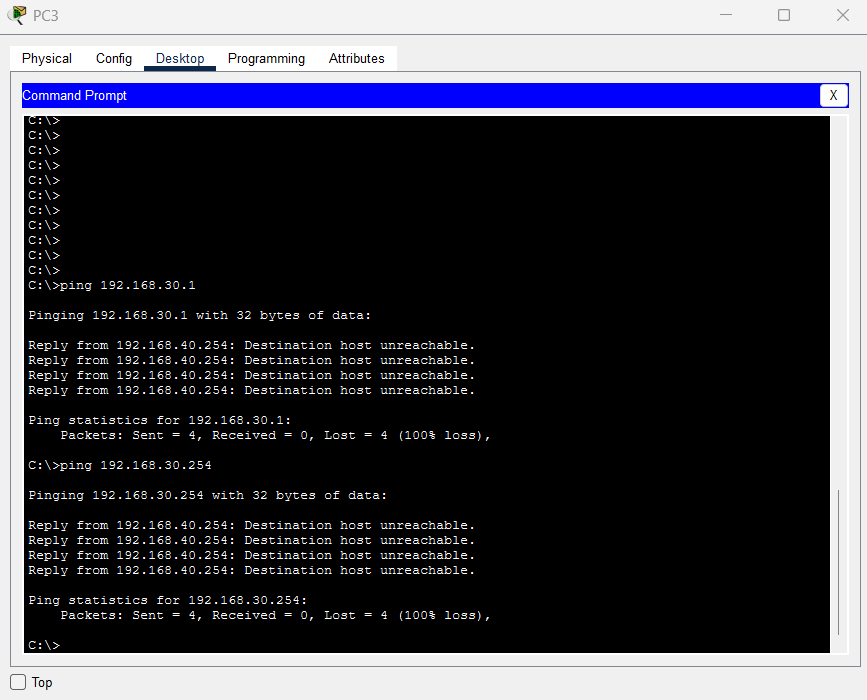

*Figure 6: PC3 command prompt after the inbound ACLs were applied. The pings to PC2 (Test C) and to the Branch Management gateway (Test F) are both blocked, with replies from `192.168.40.254`.*

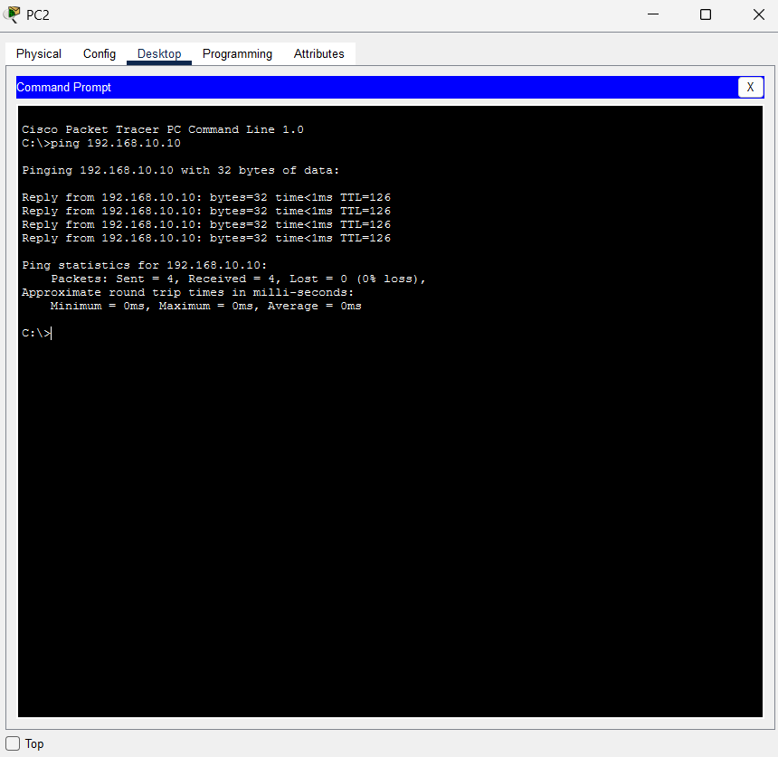

*Figure 7: PC2 command prompt. The ping from Branch IT to the HQ Syslog Server succeeds (Test D).*

**Gateway exposure: before and after the inbound ACLs**

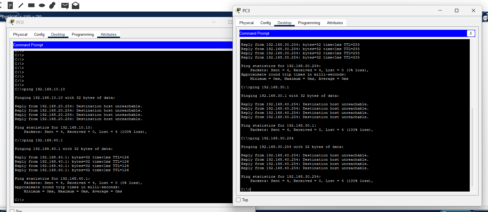

*Figure 8: PC3 command prompt. At the top, the earlier ping to `192.168.30.254` succeeds (four replies, TTL=255). Below it, after `BRANCH_USERS_IN` was applied, the pings to `192.168.30.1` (Test C) and `192.168.30.254` (Test F) are both blocked, with replies from `192.168.40.254`.*

**ACL hit counters**

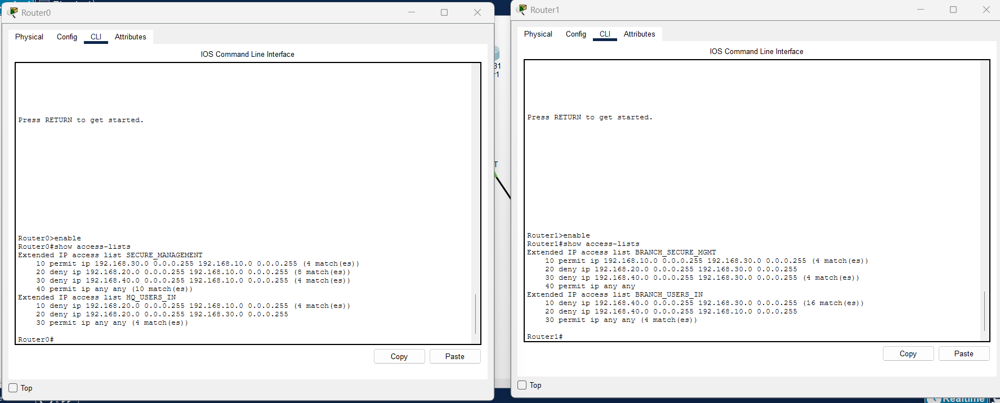

*Figure 9: `show access-lists` on Router0 (left) and Router1 (right). The new inbound ACLs now do the first-line filtering: `HQ_USERS_IN` shows 4 matches on the VLAN 20 to VLAN 10 deny and 4 on the final permit, and `BRANCH_USERS_IN` shows 16 matches on the VLAN 40 to VLAN 30 deny and 4 on the final permit. The outbound deny counters (for example 8 and 4 on `SECURE_MANAGEMENT`) are left over from the initial design, before the inbound ACLs existed. The counters were not cleared, so the figures are cumulative across several test runs. Lines with no matches (the cross-site deny lines in the inbound ACLs and the HQ Users deny in `BRANCH_SECURE_MGMT`) cover traffic that was not generated in these tests.*

### 5.3 Router Syslog Verification

* **Test:** An administrative `shutdown` was executed on `interface loopback 0` on Router1 (Branch), after first bringing it up with `no shutdown`.
* **Result:** Server0 (HQ) logged four entries from `10.0.0.2` (Router1's WAN address) with millisecond timestamps: two at `02:03:40` and two at `02:03:51`, matching the two sets of loopback state-change messages in the Router1 console (the first after `no shutdown`, the second after `shutdown`).
* **Explanation:** Router1 sources its Syslog UDP packets from its egress WAN interface (`10.0.0.2`). When Router0 routes the packet out of `G0/0/1.10`, `SECURE_MANAGEMENT` evaluates the source IP `10.0.0.2`, finds no matching `deny` statement, and permits the log through the final `permit ip any any` rule.

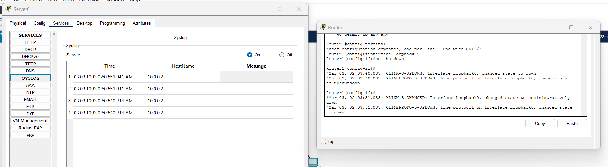

*Figure 10: Server0 Syslog service (left) shows four entries received from `10.0.0.2` within seconds of the loopback state changes. Packet Tracer truncates the Message column in the server table, so the corresponding state-change messages are shown in the Router1 console (right). The `*` prefix on the console messages means the router clock is not synchronized, so the dates are Packet Tracer defaults (see Future Improvements). The garbled `upshutdown` text is a console display artifact from the next command being typed while the log message printed.*

---

## 6. Conclusion, Limitations & Future Improvements

* **Layered ACL Architecture:** The initial design applied ACLs only outbound on the management sub-interfaces (`G0/0/1.10` and `G0/0/1.30`), which protected the management subnets from both local and WAN-originated user traffic. After review, inbound ACLs were added on the user sub-interfaces (`G0/0/1.20` and `G0/0/1.40`), so unauthorized traffic is now dropped at its source and enforced a second time at the destination (defense in depth).
* **Gateway Exposure: Found, Fixed and Re-tested:** During testing, a restricted Branch User could still ping the Branch Management gateway (`192.168.30.254`) while the endpoint behind it (`192.168.30.1`) was blocked (Figure 8, upper part). An outbound ACL only evaluates traffic forwarded *out* of an interface, and traffic destined for the router's own interface IP is processed internally and never exits it. Applying the inbound ACL on the user sub-interface closes the gap, because the deny matches the entire management subnet, gateway IP included. The re-test (Figures 6 and 8) shows the same ping now blocked.
* **DHCP Exclusion Precision:** `ip dhcp excluded-address` requires an exact single IP or range. Entering a subnet mask alongside the network address during initial setup exhausted the DHCP pool and caused endpoints to fall back to APIPA (`169.254.x.x`). Negating the faulty command and excluding only the `.254` gateway addresses resolved the issue.
* **Trunk Restriction Verified:** An early verification showed the trunks still carrying VLANs 1-1005 because the allowed-VLAN command had not been applied. Re-applying it and re-checking `show interfaces trunk` confirmed that each trunk now carries only its own VLANs (Figure 2).
* **Scope and Limitations:** This lab focuses on segmentation, routing and access control. Device hardening (passwords, SSH), Layer 2 port hardening and time synchronization were out of scope and are listed below.

**Future Improvements**

1. **Device hardening and secure remote management:** Set `enable secret`, console and VTY passwords, `service password-encryption` and a login banner. Configure SSHv2 with RSA keys on all routers and switches, disable Telnet (`transport input ssh`), and apply an `access-class` ACL to `line vty 0 4` so remote access is limited to VLAN 10 and VLAN 30.
2. **Whitelist (default-deny) policy:** Replace the blacklist model with a whitelist for the management VLANs. With `permit ip any any`, anything sourced from the WAN addresses (`10.0.0.1`, `10.0.0.2`) can currently reach the management VLANs. A tighter policy would permit only what is needed, for example `permit udp host 10.0.0.2 host 192.168.10.10 eq 514` for Syslog, ICMP and SSH, and deny the rest. On the user sub-interfaces, a whitelist must also explicitly permit DHCP (`udp any eq bootpc any eq bootps`) and any other required services, or user connectivity breaks.
3. **Switch logging and management:** Configure management SVIs (`interface vlan 10` and `interface vlan 30`) with default gateways on `Switch0` and `Switch1`, so the Layer 2 switches can be managed and can forward Syslog messages to `192.168.10.10`.
4. **Layer 2 hardening:** Change the native VLAN away from VLAN 1, set `switchport nonegotiate` on trunks, and shut down unused ports (currently in VLAN 1) or move them to an unused VLAN. Enable port security (`switchport port-security`) on access ports, especially the Branch Management port, which is served by DHCP, to mitigate MAC spoofing and CAM table overflow attacks.
5. **Time synchronization:** Configure NTP (or `clock set` in a lab) so log timestamps show real time instead of the default dates and the `*` prefix.
6. **Edge connectivity:** Implement PAT/NAT (`ip nat inside source list ... overload`) and a default static route (`ip route 0.0.0.0 0.0.0.0 ...`) on HQ Router0, advertised into OSPF with `default-information originate`, to provide Internet connectivity.
7. **OSPF refinements:** Set `ip ospf network point-to-point` on both WAN interfaces to avoid the unnecessary DR/BDR election, and configure explicit `router-id` values (for example 1.1.1.1 and 2.2.2.2), because automatic selection depends on loopback addresses and on when the process started.
8. **Resilience and performance:** Replace router-on-a-stick with a Layer 3 switch or add redundant uplinks to remove the single-trunk bottleneck and single point of failure.
